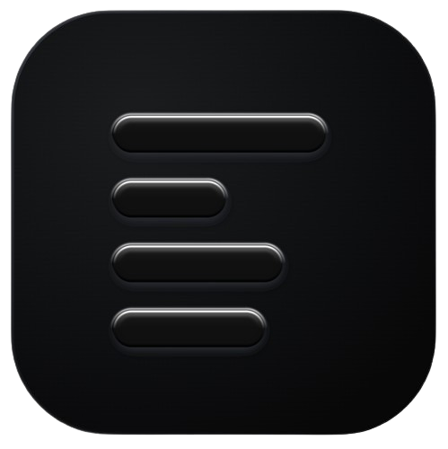

<h1>syki</h1>

<strong>思考を即座に受け止める膜。</strong>

Rust + Win32 + WebView2 製の超軽量 Windows ネイティブ・スクラッチパッド＆AI ワークフロー基盤。

  
  
  
  

  <code>&lt; 5 ms</code> CLI ·
  <code>&lt; 15 ms</code> 復帰 ·
  <code>3–5 MB</code> 待機 RAM

  <a href="README.md">English</a> · <strong>日本語</strong>

---

## コアコンセプト

- **保管庫ではなく「膜」。** プレーン Markdown（`scraps/YYYY-MM-DD.md`）、ロックインゼロ。
- **呼ぶまで眠る。** `Attached` → `Suspended` → `Detached`（トレイ常駐 RAM 3–5 MB）。
- **高速な核、遅延ロードの皮。** 純 Rust コア（`syki-core`）。`user.css` と `plugins/` で自在に拡張。

## 主な機能（5 選）

| # | 機能 | 内容 |
|---|---|---|
| **01** | **即時キャプチャ** | ~1 ms Win32 Quick Capture、画面切り抜き、ローカル STT / WASAPI 会議録音、Vision OCR |
| **02** | **Markdown スタジオ** | 分割タブ、日本語 IME Guardian、KaTeX / Mermaid プレビュー、CDP PDF、内蔵 ConPTY 端末 |
| **03** | **ハイブリッド検索** | プレーンテキスト Scrap 横断の並列全文検索 ＋ `mmap` SIMD 意味検索 |
| **04** | **ローカル優先 AI** | インライン書き換え、補完、Vision OCR、画像生成 — ローカル OpenAI 互換または Gemini |
| **05** | **CLI ＆ プラグイン** | `syki-cli` 標準入力パイプ ＆ Named Pipe JSON-RPC、`user.css`、サンドボックス `window.syki` プラグイン |

---

## クイックスタート（3 ステップ・AI エージェント前提）

1. **ダウンロード＆起動** — [Releases](https://github.com/youshinh/syki/releases) から `syki-*-windows-x64.zip` を解凍して `syki.exe` を起動*（`syki-cli` 用にフォルダを `PATH` へ追加）*。
2. **スキルを読み込む** — 同梱の `skills/syki-customize/SKILL.md`*（原本: [`SKILL.md`](frontend/resources/syki-customize/SKILL.md)）* を AI エージェントへ登録。
3. **聞く＆任せる** — 使い方・ショートカット・トラブルシュートをエージェントに質問し、`config.json` 設定・`user.css`・プラグイン作成・`syki-cli` 操作まで委譲。

## ライセンス ＆ 商標

[MIT License](LICENSE) のもとで公開されています。

Windows および WebView2 は Microsoft Corporation の商標です。Gemini は Google LLC の商標です。OpenAI は OpenAI, Inc. の商標です。その他すべての商標は各所有者に帰属します。本プロジェクトはこれら各社とは独立しており、提携・承認されたものではありません。

