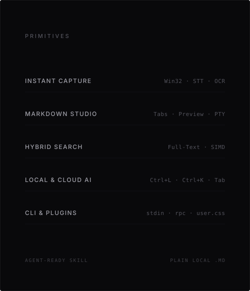

# syki

  
  
  
  

An instant, featherweight Markdown scratchpad. &nbsp;[日本語](README.ja.md)

  
  

---

### Core Concept

- **Membrane, not a vault.** Plain `.md`, zero lock-in.
- **Dormant until summoned.** 3–5 MB idle, `< 15 ms` wake.
- **Fast core, lazy skin.** Rust core; extend via `user.css` & `plugins/`.

---

### Capabilities

| # | Capability | Scope |
| :--- | :--- | :--- |
| **01** | **Instant Capture** | ~1 ms popup, screen grab, local STT / WASAPI, Vision OCR |
| **02** | **Markdown Studio** | Split tabs, IME Guardian, KaTeX / Mermaid, PDF, PTY |
| **03** | **Hybrid Search** | Full-text + `mmap` SIMD semantic search |
| **04** | **Local-First AI** | Inline rewrite, autocomplete, Vision OCR, image gen |
| **05** | **CLI & Plugins** | `syki-cli` pipes & RPC, `user.css`, `window.syki` plugins |

---

### Quick Start

1. **Download** — Unzip `syki-*-windows-x64.zip` from [Releases](https://github.com/youshinh/syki/releases/latest) and run `syki.exe`.
2. **Load Skill** — Add `skills/syki/SKILL.md` to your AI agent.
3. **Ask & Extend** — Ask your agent how to use, configure, style, or extend `syki`.

---

### License

[MIT](LICENSE)
