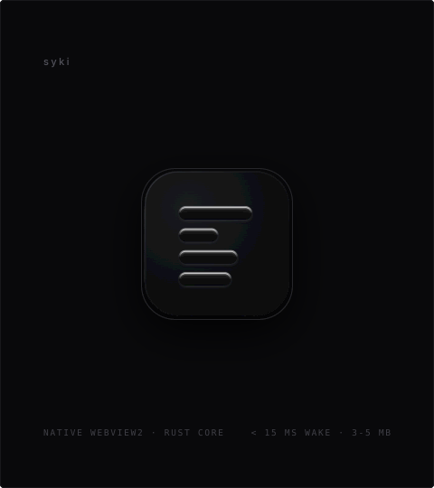

# syki

  
  
  
  

An instant, featherweight Windows-native Markdown scratchpad & AI workflow kernel in Rust. &nbsp;**English** · [日本語](README.ja.md)

  
  

---

### Core Concept

- **Membrane, not a vault.** Plain Markdown (`scraps/YYYY-MM-DD.md`), zero lock-in.
- **Dormant until summoned.** `Attached` → `Suspended` → `Detached` (3–5 MB idle RAM, `< 15 ms` wake).
- **Fast core, lazy skin.** Pure Rust kernel (`syki-core`); extend via `user.css` and `plugins/`.

---

### Capabilities

| # | Capability | Scope |
| :--- | :--- | :--- |
| **01** | **Instant Capture** | ~1 ms Win32 Quick Capture, screen grab, local STT / WASAPI meeting audio, Vision OCR |
| **02** | **Markdown Studio** | Split tabs, Japanese IME Guardian, KaTeX / Mermaid preview, CDP PDF, ConPTY terminal |
| **03** | **Hybrid Search** | Parallel full-text + `mmap` SIMD semantic search across plain-text Scraps |
| **04** | **Local-First AI** | Inline rewrite, autocomplete, Vision OCR, image gen — local OpenAI-compatible or Gemini |
| **05** | **CLI & Plugins** | `syki-cli` stdin pipes & Named Pipe JSON-RPC, `user.css`, sandboxed `window.syki` plugins |

---

### Quick Start (3 Steps · AI Agent First)

1. **Download & Launch** — Unzip `syki-*-windows-x64.zip` from [Releases](https://github.com/youshinh/syki/releases/latest) and run `syki.exe` *(add folder to `PATH` for `syki-cli`)*.
2. **Load the Skill** — Register the bundled `skills/syki-customize/SKILL.md` *(source: [`SKILL.md`](frontend/resources/syki-customize/SKILL.md))* in your AI agent.
3. **Ask & Delegate** — Ask your agent how to use `syki` (shortcuts, features, troubleshooting), or let it configure `config.json`, style `user.css`, build plugins, and drive `syki-cli`.

---

### License & Trademarks

Released under the [MIT License](LICENSE).

Windows and WebView2 are trademarks of Microsoft Corporation. Gemini is a trademark of Google LLC. OpenAI is a trademark of OpenAI, Inc. All other trademarks belong to their respective owners; this project is independent and unaffiliated.

