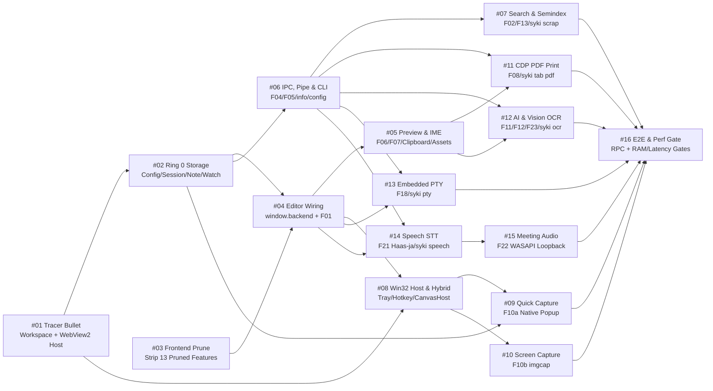

# syki-lite (Rust / Windows Native Rewrite) — Master Specification

## 1. Purpose & Domain Identity
`syki-lite` is a clean-start Windows-only Rust rewrite of `syki::sok` designed for maximum runtime speed, minimal resident memory, and crash-free stability, while preserving backward compatibility with existing `scraps/`, `config.json`, and `semindex` data.

Per `GLOSSARY.md` and `docs/adr/0002-three-ring-autotomy-and-local-first-seam.md`:
- **Stream Kernel (Ring 0)**: `syki-core` — GUI-independent core handling Scrap/Wiki persistence, search, `semindex`, Local-First Inference Seam, speech integration, ConPTY management, and JSON-RPC dispatch.
- **Editor Canvas (Ring 1)**: `syki-win` + pruned `frontend/` — single-window Win32 + WebView2 UI (`markdown-it`, `KaTeX`, `Mermaid`, `xterm.js`), Japanese IME Guardian (`imm32`), CDP PDF printing, plus Win32 native `Quick Capture` and `imgcap` overlays.
- **Receptor Organelles (Ring 2 — Pruned)**: Network/hot-folder receptors (`Mobile Drop`, `CF Bridge`, `Inbox`) are completely omitted. Local audio capture (WASAPI loopback + mic) and `speech.cpp` server lifecycle sit cleanly isolated behind trait boundaries.

---

## 2. Locked Architectural Decisions

| Axis | Decision |
|---|---|
| **Repository & Scope** | Clean-start new repo (`syki-lite`), Windows-only, **single main window** (with split panes + Quick Capture popup; no `--new-window`, no macOS code). |
| **Native Stack** | Rust + Microsoft official `windows` + `webview2-com` crates directly (no `wry`/`tao`, no `powershell.exe` child spawns). |
| **Virtual Origin & Assets** | `https://app.syki.local/` served in-memory via `WebResourceRequested` from `build.rs`-bundled `include_bytes!` assets, plus dynamic routes `/api/print/preview.pdf` and `/api/local-asset`. |
| **JS ↔ Rust Bridge** | Single native COM JSON-RPC channel via `PostWebMessageAsJson` + `WebMessageReceived` (`RpcRequest`/`RpcResponse`/`RpcEvent`), adapted by a thin JS `window.backend` proxy shim (replaces 176 individual binds). |
| **Hybrid Memory Lifecycle** | `CanvasHost` 3-state machine: `Attached` → `SuspendedLowMem` (`TrySuspend` + `MemoryUsageTargetLevel::LOW`) → timed `Detached` (controller destroyed; **3–5 MB** resident RAM). Protected by synchronous pre-detach session flush, active-task detach guard, and CLI auto-reattach. |
| **Data Compatibility & Coexistence** | Reads/writes existing `scraps/*.md`, `config.json` (tolerating unknown pruned keys), `semindex/` (`manifest.json`, `chunks.jsonl`, `vectors.bin`), and `ipc-session.json`. Supports `SYKI_DATA_DIR` & `SYKI_INSTANCE_ID` overrides for collision-free side-by-side runs with legacy Go `syki.exe`. |

---

## 3. Cargo Workspace Layout

```text
syki-lite/
├── Cargo.toml
├── build.rs                 # Bundles frontend/ JS/CSS for include_bytes!
├── crates/
│   ├── syki-core/           # Ring 0: storage, config, search, semindex(mmap+SIMD),
│   │                        #         llm/vision/image, speech, pty, rpc/ipc, pipe
│   ├── syki-win/            # Ring 1: Win32 window, tray, hotkey, CanvasHost(WebView2 COM),
│   │                        #         imm32 IME, CDP PDF, QuickCapture, imgcap, WASAPI
│   ├── syki-gui/            # [[bin]] #![windows_subsystem = "windows"] -> syki.exe
│   └── syki-cli/            # [[bin]] console subsystem -> syki-cli.exe (8+1 subcommands)
└── frontend/                # Pruned Vanilla JS / HTML / CSS + vendor(katex/mermaid/xterm)
```

---

## 4. Core Seams (Level 2 Boundaries)

1. **`KernelService` (`syki-core`)**: Pure Rust async/sync service facade owning `ConfigStore`, `SessionStore`, `ScrapStore`, `SearchEngine`, `SemanticIndex`, `LlmClient`, `SpeechService`, `PtyManager`, and `CommandFilter`. Zero Win32/WebView2 types.
2. **`RpcBridge` (`syki-win` ↔ `frontend`)**: Single `PostWebMessageAsJson` dispatcher routing typed `RpcRequest { id, method, params }` → `RpcResponse { id, ok, result, error }` and server-push `RpcEvent { topic, payload }` (`llm:chunk`, `pty:data`, `speech:partial`, `file:changed`, `host:flush`).
3. **`CanvasHost` (`syki-win`)**: Owns `HWND` + `ICoreWebView2Controller` lifecycle (`Attached` / `SuspendedLowMem` / `Detached`), enforcing flush-before-detach, detach inhibition guards, and on-demand reattach for CLI RPC (`buffer`/`tab`/`ui`).

---

## 5. Feature Disposition Matrix

### Kept Features (16)
- `F01` Markdown Editor I/O (tabs, split panes, session restore, atomic save, `encoding_rs` Shift_JIS, `notify` hot-reload)
- `F02` Scrap daily notes & parallel full-text / ranked search (`ignore` + `memchr` + `regex-automata`)
- `F04` `syki-cli.exe` (`buffer`, `tab`, `ui`, `pty`, `ocr`, `speech`, `info`, `scrap`, `config`), stdin pipe (`cat | syki`), single-instance IPC, JSON-RPC
- `F05` Shell pipe (`Ctrl+E`)
- `F06` Live Markdown preview (`markdown-it`, `KaTeX`, `Mermaid`)
- `F07` Japanese IME Guardian & `ime_retype` (`imm32`)
- `F08` Print preview & CDP PDF export (`Page.printToPDF`)
- `F10a` Win32 native Quick Capture popup (works in ~1 ms even while WebView2 is `Detached`)
- `F10b` Win32 screen region capture (`imgcap`)
- `F11` Cursor AI (`Ctrl+L`, `Ctrl+K` inline rewrite, `Alt+C`, `Tab` autocomplete; OpenAI-compatible + Gemini)
- `F12` Image generation & infographic prompt (OpenAI-compatible + Gemini)
- `F13` Semantic search (`semindex` with `memmap2` + SIMD cosine scan)
- `F18` Embedded PTY terminal (`portable-pty` ConPTY + `xterm.js` + git worktree helper)
- `F21` Local STT (`speech.cpp` + `Haas-ja` default + OpenAI-compatible STT; pure Rust `symphonia`+`rubato` WAV transcoding)
- `F22` Meeting recording (typed COM WASAPI loopback + mic dual capture & mix)
- `F23` Image paste & **AI OCR only** (Vision LLM via OpenAI-compatible VLM / Gemini Vision + `syki ocr <image>`)

### Explicitly Pruned Features (Out of Scope)
`F03` `tagEdit`, `F09` Sticky Notes & Mermaid AI repair, `F14` Deep Search, `F15` JEV (`mvdan.cc/sh/v3` / Auto Selector), `F16` Slot Agent (`{{ }}`), `F17` Lessons, `F19` Ollama service auto-control/install, `F20` `skillinstall`, `F23` WinRT OCR (`Windows.Media.Ocr`), `F24` Mobile Drop, `F25` Cloudflare Bridge, `F26` Hot-Folder Inbox, `F27` Git Sync, `F28` Config Pack, old `whisper.cpp` + `pkg/components` model auto-downloader, macOS support, `--new-window` multi-window.

---

## 6. Dependency DAG (16 Vertical-Slice Tasks)



## 7. Quantitative Acceptance Gates (Verified in #16)
- `syki-cli.exe --version` cold start: **< 5 ms**
- Global hotkey wake (`Attached` / `SuspendedLowMem`): **< 15 ms**
- `Detached` tray idle resident RAM (`syki.exe` total process tree): **3–5 MB**
- `powershell.exe` child process spawns across entire runtime: **0**
